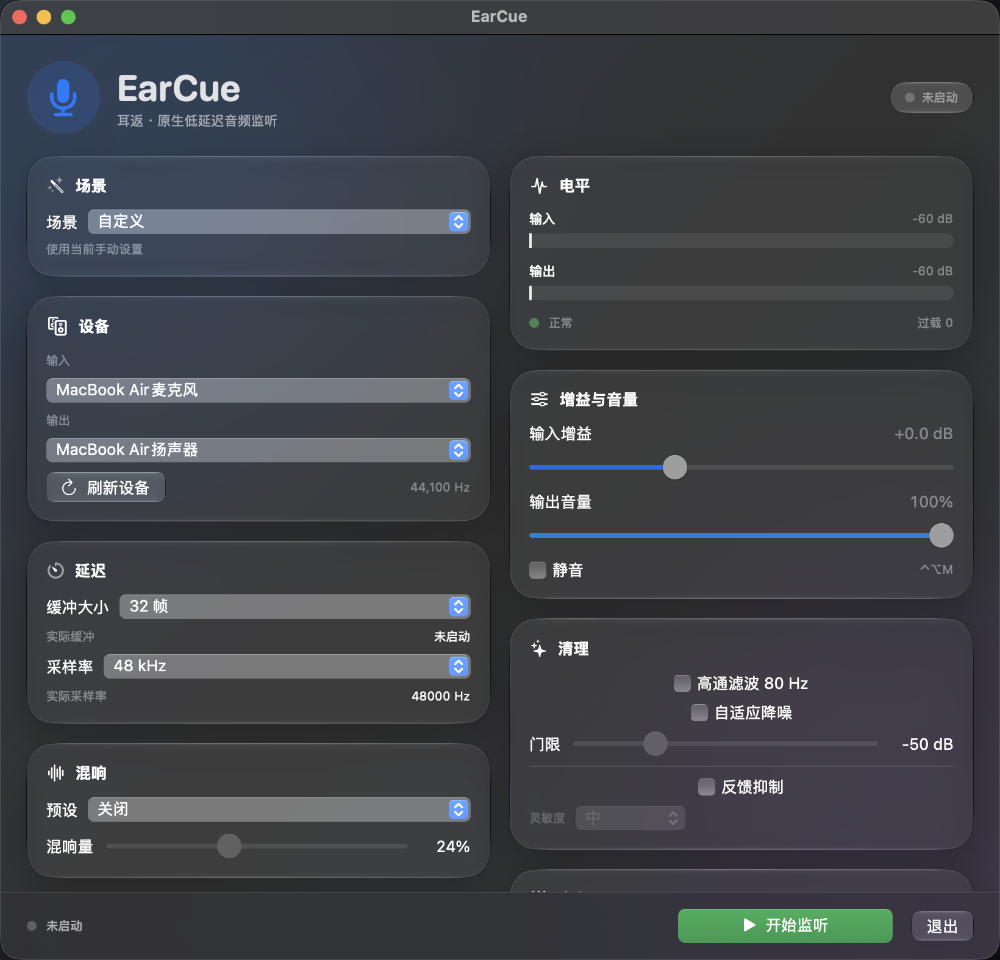

# EarCue 耳返

A native, low-latency macOS audio monitor. Hear your microphone through headphones or speakers, with feedback suppression, adaptive noise reduction, reverb, EQ, and a menu bar controller.



## Features

- **Native app** — SwiftUI UI + Core Audio **AUHAL** engine, no Python or PortAudio
- **Low latency** — 16 / 32 / 64 / 128 / 256-frame buffers, 44.1 / 48 / 96 kHz
- **Adaptive feedback suppression** — 48-band Goertzel howl detection, 4 adaptive notches, 3 sensitivity levels
- **Adaptive noise reduction** — 80 Hz high-pass + noise-floor-tracking soft expander, no added latency
- **Tone** — 3-band EQ, compressor, always-on safety limiter
- **Reverb** — Room / Hall / Large Hall, live wet control
- **Gain & mute** — input gain, output volume, global `⌃⌥M` mute shortcut
- **Meters** — smoothed dBFS input/output meters, peak hold, clip and overload diagnostics
- **Scenes** — 播客 / 唱歌 / 游戏 / 会议 presets
- **Native device handling** — Core Audio hotplug listeners, no polling
- **Menu bar popover** — start/stop, mute, volume, devices, scenes, Show Window
- **Launch at login** — `SMAppService`
- **macOS 26/27 Liquid Glass** — glass cards and buttons with a material fallback on older systems

## Build & run

Requirements: macOS 14 or later, Xcode Command Line Tools.

```bash
git clone https://github.com/breeze303/earcue.git
cd earcue
./build_app.sh
open "dist/EarCue.app"
```

The app is ad-hoc signed locally. If macOS blocks the first launch, right-click the app and choose **Open**, or run:

```bash
xattr -cr "dist/EarCue.app"
```

On first **Start Monitoring**, macOS will ask for microphone access. Allow it.

## Controls

- **场景** — 播客 / 唱歌 / 游戏 / 会议 / 自定义
- **设备** — choose Core Audio input/output; **刷新设备** for manual refresh
- **延迟** — buffer size and sample rate
- **增益与音量** — input gain, output volume, mute (`⌃⌥M`)
- **清理** — high-pass, adaptive noise reduction threshold, feedback suppression + sensitivity
- **音色** — 3-band EQ (120 Hz / 1 kHz / 6 kHz), compressor threshold/ratio
- **混响** — Off / Room / Hall / Large Hall, Mix
- **诊断** — overloads, clipped samples, feedback notches, callbacks, actual buffer
- **底部操作栏** — Start / Stop Monitoring is always visible

## Feedback suppression and noise reduction

Feedback suppression is **off by default**, because aggressive detection can notch sustained musical tones. Enable it in **清理 → 反馈抑制** and start with **中** sensitivity. The diagnostics panel shows how many notches are currently active.

The noise reduction is a **time-domain adaptive expander** with noise-floor tracking; it adds no latency. It is not a spectral denoiser. A spectral denoiser would add roughly 10 ms of latency.

## Legacy Python version

The original Python/rumps implementation is kept under `legacy/python/`:

```bash
cd legacy/python
python3 -m venv venv
source venv/bin/activate
pip install -r requirements.txt
python3 app.py
```

It uses [sounddevice](https://python-sounddevice.readthedocs.io/) (PortAudio) and [rumps](https://github.com/jaredks/rumps). The native app above is the recommended version.

## Credits

EarCue is a native rewrite based on [Hear Yourself](https://github.com/gabrycina/hear-yourself) by Gabrycina & Claude Opus. The legacy Python code retains its original attribution.
